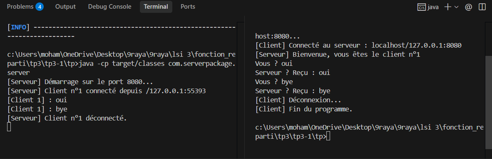

# TP3.1 : Application Client/Serveur Multi-thread avec Sockets Java

Ce TP met en place une architecture client/serveur TCP multi-threadée en Java. Le serveur, en écoute sur le port 8080, accepte les connexions de plusieurs clients en simultané en attribuant à chacun un identifiant unique et en déléguant le traitement à un thread dédié (`ClientHandler`). Le client se connecte au serveur, envoie des messages textuels et reçoit en retour un accusé de réception (écho). La saisie du mot-clé "bye" permet de clore la session proprement. Ce projet permet d'illustrer la gestion de la concurrence, les sockets TCP et la communication réseau non bloquante en Java.

## Execution

