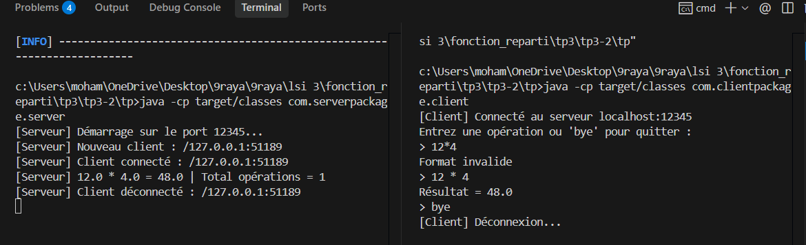

# TP3.2 : Application Client/Serveur Multi-thread avec Objets et Sockets Java

Ce TP met en place une architecture client/serveur TCP multi-threadée en Java combinée à la sérialisation d'objets. Le client saisit une expression arithmétique, l'encapsule dans un objet sérialisable `operation`, puis l'envoie via un flux `ObjectOutputStream`. Le serveur, en écoute sur le port 12345, gère chaque client de manière concurrente grâce à un thread dédié (`ClientHandler`). Il réceptionne l'objet à l'aide d'un `ObjectInputStream`, effectue le calcul (+, -, *, /, avec gestion des erreurs comme la division par zéro), comptabilise le total des opérations globales (`AtomicInteger`), et retourne l'objet enrichi du résultat. Ce projet illustre l'intégration conjointe du multi-threading, des sockets TCP et de la sérialisation d'objets en Java.

## Execution

