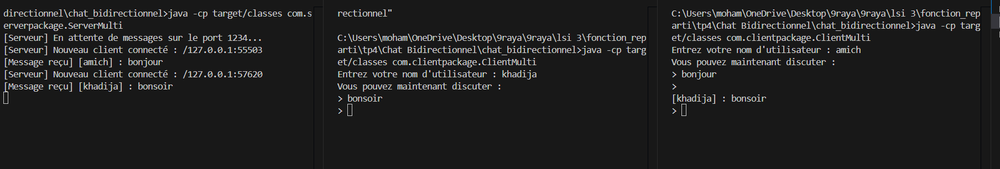

# TP4.2 : Application de Chat Multi-utilisateurs avec Sockets UDP et Threads

Ce TP implémente une salle de discussion (chat multi-utilisateurs) bidirectionnelle en Java en s'appuyant sur les sockets UDP (`DatagramSocket`, `DatagramPacket`) et la programmation concurrente. Le serveur, à l'écoute sur le port 1234, maintient dynamiquement la liste des adresses des clients connectés (`Set<SocketAddress>`) et relaie chaque message reçu à l'ensemble des autres participants (broadcast). Le client initialise un thread d'écoute dédié pour réceptionner et afficher les messages entrants en continu et de manière asynchrone, tout en permettant à l'utilisateur de saisir et d'émettre des messages en temps réel depuis le thread principal. Ce projet illustre la gestion du broadcast applicatif en UDP et la synchronisation des échanges bidirectionnels grâce au multi-threading.

## Execution

