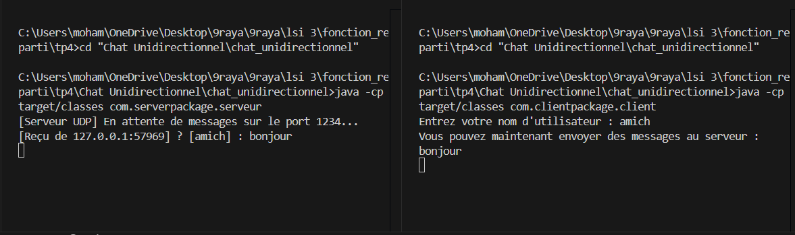

# TP4.1 : Application Client/Serveur UDP - Chat Unidirectionnel

Ce TP met en place une communication client/serveur en mode non connecté à l'aide des sockets UDP (`DatagramSocket` et `DatagramPacket`) en Java. Le client invite l'utilisateur à saisir un nom d'utilisateur, puis lit les messages depuis l'entrée standard, les encapsule au format `[nom] : message` dans des datagrammes et les transmet au serveur via le port 1234 (`localhost`). Le serveur est lié au port 1234, reste en attente de paquets grâce à un tampon de réception de 1024 octets, extrait le contenu ainsi que l'adresse IP et le port de l'émetteur, puis affiche le message reçu. Ce projet permet d'appréhender les principes fondamentaux de la transmission de données sans connexion par paquets UDP.

## Execution

